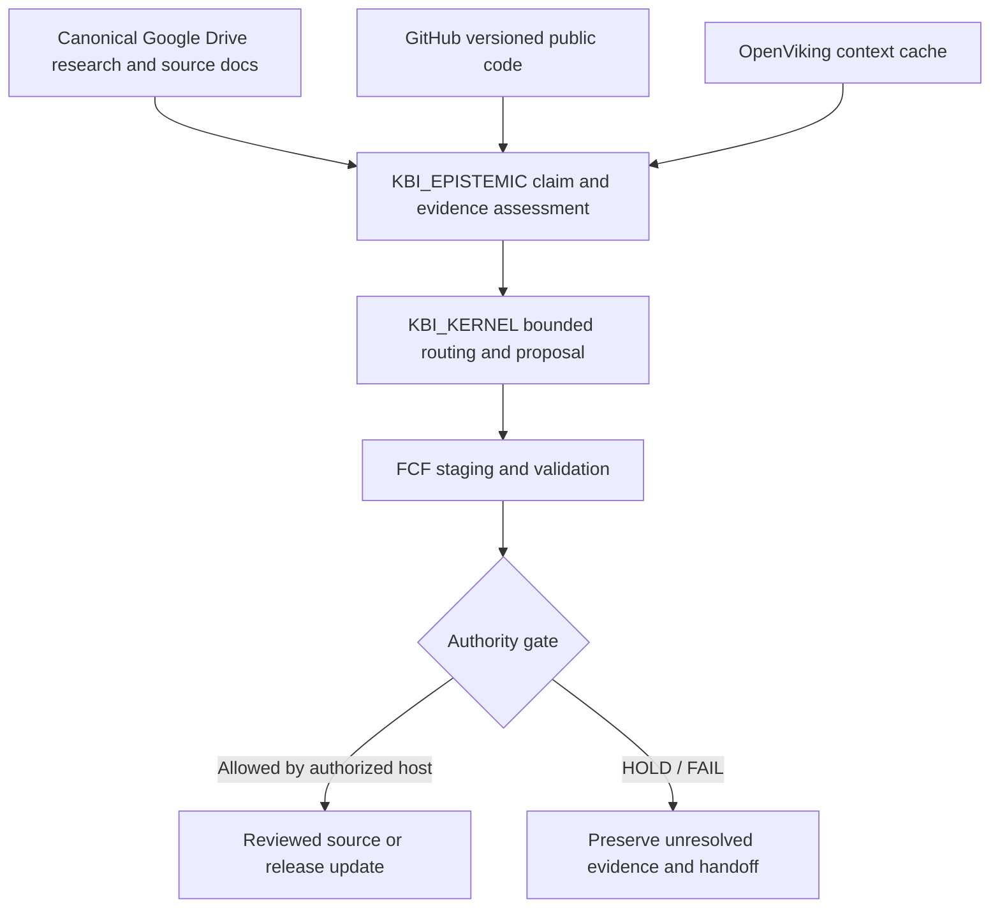

# FABRICA Context Fabric (FCF)

> **Public source export:** internal Google Drive document identifiers have been redacted. Replace template references only with authorized canonical sources; the shipped placeholders are deliberately non-live.


[](#validation-and-claim-boundary) [](pyproject.toml) [](LICENSE)

**Independent context-governance reference layer for persistent AI agent systems.** FCF complements [OpenViking](https://github.com/volcengine/OpenViking) by separating retrieved context, claims and evidence, authority, canonical source revisions, and state-changing execution. It is developed within FAB.SYS / CodexStation Ω.

> **Public status**: `v0.4.0 KBI REFERENCE CANDIDATE`. Local tests and simulated HTTP contract have passed; genuine OpenViking server integration, deployment assurance, regulatory compliance, and production-level authentication have **not** been established.

## Why FCF?

A memory may accurately capture what was said without proving it is true. A retrieved document may contain instructions the agent must not execute. A file hash proves byte agreement, not who published it. FCF makes these separations explicit and supplies a small, inspectable reference implementation to test them.

## Architecture



## Quick start (no OpenViking server required)

```bash
python -m venv .venv
. .venv/bin/activate
pip install -e .
PYTHONPATH=src python -m fcf.kbi.validate --root .kbi
PYTHONPATH=src python -m unittest discover -s tests -v
python validation/check_schemas.py
PYTHONPATH=src python cases/dft_reference_case.py
```

`python -m fcf --help` shows the source snapshot / memory proposal CLI. See `docs/P03_OPERATIONAL_RUNBOOK.md` for synthetic-only OpenViking v0.5.0 acceptance instructions. No provider credentials should be committed.

## Project-bound `.kbi` capsule

- `.kbi/kernel.kbi.json` — separately named KBI_KERNEL and KBI_EPISTEMIC modules.
- `.kbi/lattice.json` — finite dependency order for bounded NEXT() execution.
- `.kbi/sources.json` — authoritative source addresses, not live revision snapshots.
- `.kbi/claims.json` — initial claim and deployment debt registry.
- `.kbi/promotion-gates.json` — fail-closed gates for Drive edits, GitHub release, OpenViking.
- Root `AGENTS.md` — agent-consumable projection; never grants host capabilities.

To generate a safe **candidate capsule** for a different sovereign Drive R&D project, run:

```bash
PYTHONPATH=src python -m fcf.kbi.scaffold \
  --project-id example-research \
  --canonical-root https://drive.google.com/drive/folders/EXAMPLE \
  --start-url https://docs.google.com/document/d/EXAMPLE_START/edit \
  --handoff-url https://docs.google.com/document/d/EXAMPLE_HANDOFF/edit \
  --output /tmp/example-kbi-candidate
```

The scaffold is **NOT INSTALLED, NOT AUTHORIZED**. Read the target project live and review before moving it. Source IDs and project identities are refabricated, with all protected gates initially HOLD.

For portability see [dual-lineage specification](docs/kbi/DUAL_LINEAGE_AND_PORTABILITY.md), [agent workflow](docs/kbi/AGENT_WORKFLOW.md) and [GitHub release contract](docs/kbi/PUBLICATION_CONTRACT.md).

## Canonical R&D working tree

[Google Drive — FABRICA_CONTEXT_FABRIC_CANONICAL_WORKING_TREE](https://drive.google.com/drive/folders/PROJECT_FOLDER_ID_REDACTED) retains native `FCF_START_HERE`, `FCF_STATE_AND_HANDOFF`, and a living scientific White Paper. Its current live content supersedes any stale copy here. GitHub, when enabled, governs **versioned public code** but not private/canonical manuscript revisions.

## Validation and claim boundary

The source tree implements immutable SHA-256 source capture, bounded proposal assessment, source integrity checks and read-only OpenViking HTTP probes. Unit tests include simulated HTTP responders, **not a genuine OpenViking server**. The KBI validator verifies machine syntax and graph closure; it does not prove scientific truth, authorization or agent skill deployment.

## Security and licensing

- FCF source code is Apache-2.0. OpenViking's independent code is AGPLv3; no upstream source code is copied into FCF.
- Production credentials, tenant isolation, semantic correctness and legal clearance require separately verified controls.
- Report security issues privately through appropriate repository channels when deployed; do not include passwords, tokens, secrets or unpublished research in public issues.

## Development and contributions

Read [AGENTS.md](AGENTS.md), then [CONTRIBUTING.md](CONTRIBUTING.md), [SECURITY.md](SECURITY.md), [v0.4 technical White Paper](docs/FCF_WHITE_PAPER_v0.4.md), [roadmap](docs/ARCHITECTURAL_ROADMAP.md), [evidence matrix](docs/P03_EVIDENCE_MATRIX.md) and [changelog](CHANGELOG.md). Include deterministic tests, source version references, and claim boundaries in PRs. Proposed public releases require review and a positive release gate.
